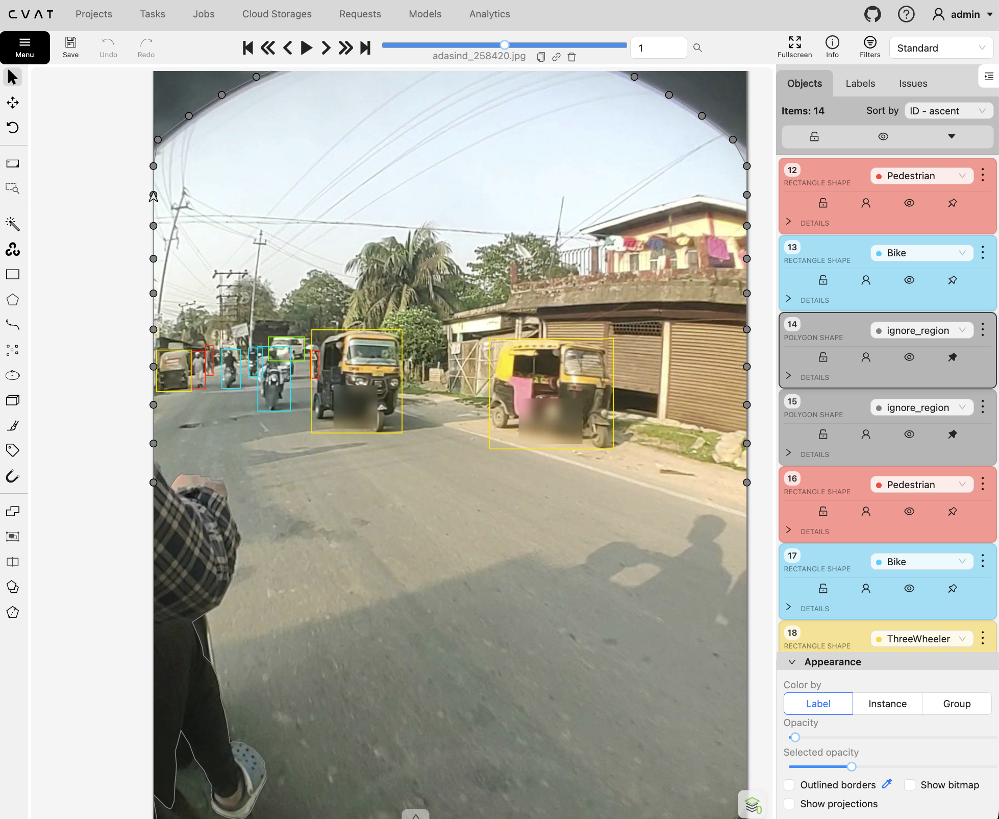
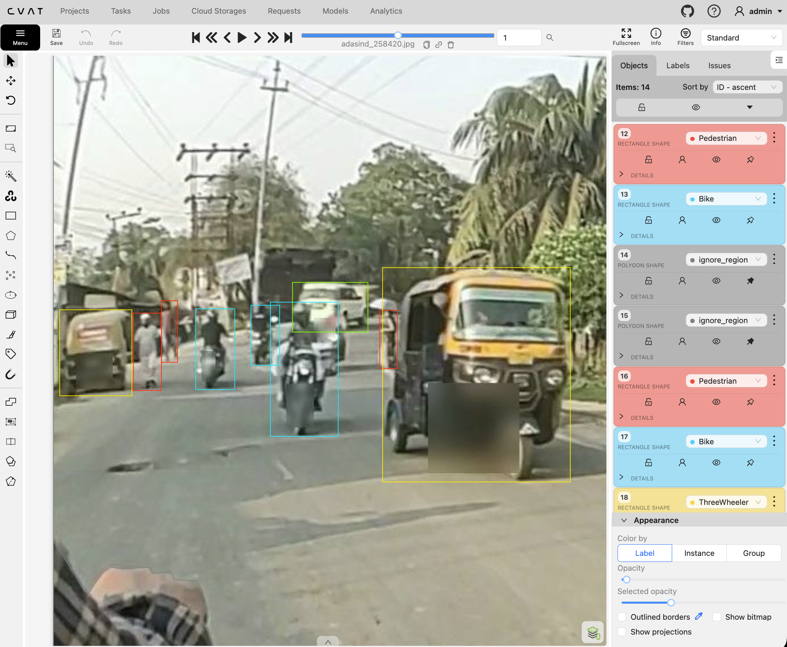

# Error analysis card

## Zone × block

| zone | block | what | count |
|---|---|---|---:|
| center | B4 | MISSING | 2 |
| center | B4 | SPURIOUS | 2 |
| center | C0 | MISSING | 1 |
| center | C0 | SPURIOUS | 1 |
| edge | B4 | MISSING | 1 |
| edge | B4 | SPURIOUS | 1 |
| edge | C0 | SPURIOUS | 1 |
| mid | B4 | BOX_GEOMETRY | 2 |
| mid | B4 | MISSING | 3 |
| mid | B4 | SPURIOUS | 14 |
| mid | C0 | MISSING | 1 |

## Top defects

- SPURIOUS: 19 (ví dụ frame adasind_019560.jpg)
- MISSING: 8 (ví dụ frame adasind_019560.jpg)
- BOX_GEOMETRY: 2 (ví dụ frame adasind_258420.jpg)

## Phân tích của bạn

Hai bảng trên do `python3 lab11.py card` tính từ `findings.csv`; chạy lại lệnh sẽ cập nhật bảng và giữ nguyên mục này. Viết cho lỗi nổi bật nhất, dẫn frame/`object_ref`.

- Nguyên nhân khả dĩ (`why`) và vì sao bạn nghĩ vậy: lỗi nổi nhất là SPURIOUS ở mid, block B4 (14 ca). Phần lớn là hộp chỉ model có (`M_only`, `E4_model_domain`) trên `adasind_258420.jpg` và `adasind_310008.jpg`: model thêm xe nhỏ ở cụm xa, trong khi L và R không có. Phần còn lại là hộp của người gán nhãn chỉ mình L thấy, `adasind_258420.jpg` L1 (Pedestrian khoảng 51 px) và L2 (Bike khoảng 52 px), `E1_annotator_error`. Ngưỡng 40 px làm những vệt mờ ở mid vừa đủ cao để bị vẽ thành object.
- Cách sửa và ai nhận việc (`owner`): annotator xóa hoặc nắn L1, L2 và hộp Car L8/R5 trên `adasind_258420.jpg`. Bản rework lần này giữ nguyên export đã khóa, nên số chưa đổi. `ai_team` nhận các hộp `M_only`; ca M2 được escalate vì cụm thừa này làm bảng mid không còn đo được lỗi người.
- Bằng chứng (ảnh trong `screenshots/`, dòng findings, rule): `submission/screenshots/258420-pedestrian.png` (hộp Pedestrian 15.4×51 px), `submission/screenshots/258420-frame.png` (cả frame), `findings.csv` các dòng L1/L2/M2, rule R01 và R03.

